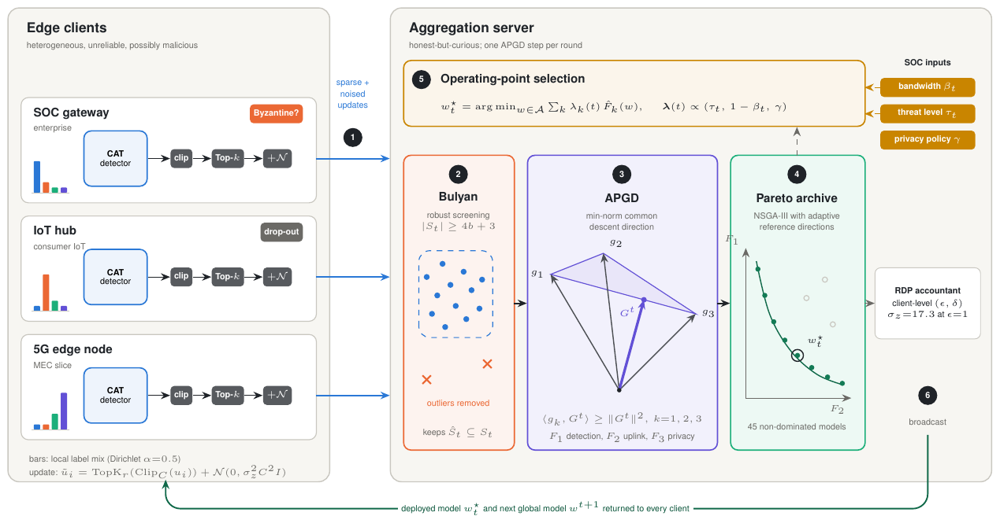
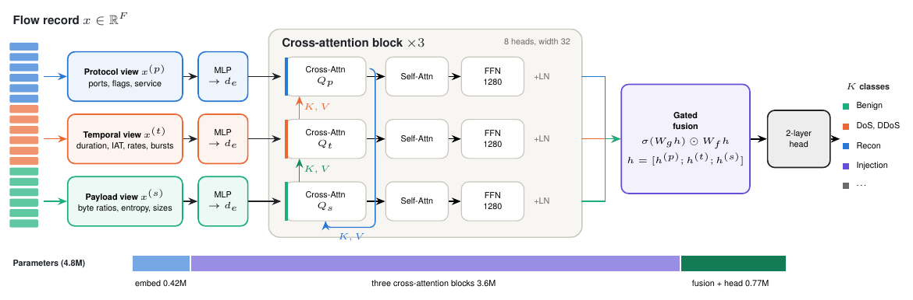

<div align="center">

# MOFedCyber

### Convergence-Guaranteed Pareto Aggregation for Private and Byzantine-Resilient Federated Intrusion Detection at the IoT–5G Edge

[](https://github.com/almadani1992/MOFedCyber-Pareto-Federated-Intrusion-Detection/actions/workflows/ci.yml)


**Ali Mansour Al-madani · Xu Ying**<br>
Hunan University · Sana'a University

*Reference implementation of the paper submitted to IEEE Access.*

</div>

<p align="center">
  
</p>

MOFedCyber trains a shared intrusion detection model across organizations without moving their traffic. It treats three quantities as competing objectives:

| Objective | Meaning | Code |
|---|---|---|
| F1 | detection risk (class-balanced cross-entropy) | estimated from client updates |
| F2 | communication cost of the update after Top-k sparsification | `mofedcyber/fl/objectives.py` |
| F3 | privacy cost of the update relative to the Gaussian noise | `mofedcyber/fl/objectives.py` |

Each round the server:
1. screens client updates with Bulyan;
2. computes a descent direction common to all three objectives (APGD, min-norm);
3. keeps a Pareto archive of models with NSGA-III;
4. deploys the archive member that best fits the current bandwidth and threat level.

Clients run a 4.7M-parameter cross-attention Transformer (CAT) and send clipped, sparsified and noised updates. This gives client-level differential privacy.

<p align="center">
  
</p>

> **Status.** This is a clean, documented re-implementation of the method as described in the paper. It is tested end to end on synthetic data (see *Tests*). Absolute numbers obtained with it depend on hardware, preprocessing and hyperparameter search, so they may differ from the values reported in the paper.

---

## Repository layout

```
mofedcyber/
  config.py            all settings (defaults = Table V of the paper)
  data/                dataset loaders, feature views, Dirichlet partition, synthetic data
  models/cat.py        cross-attention Transformer detector (Section IV-A)
  fl/
    client.py          local training (Adam/SGD, FedProx term, SCAFFOLD correction, label flipping)
    compression.py     Top-k / shared random masks, fp16 values, exact bit accounting (Prop. 1)
    privacy.py         clipping, Gaussian noise, RDP accountant, sigma calibration
    robust.py          Krum, median, trimmed mean, Bulyan, FLAME
    objectives.py      F2, F3 and their gradients (Eqs. 2-3)
    apgd.py            min-norm common descent direction (Eq. 8, Lemma 1)
    archive.py         NSGA-III archive with adaptive reference directions, selection rule (Eq. 9)
    server.py          the simulation loop: Algorithm 1 and the 12 baselines
  attacks/             Byzantine behaviours (label flip, sign flip, Gaussian, ALIE), membership inference
  metrics.py           macro-F1, confusion matrix, hypervolume, IGD, spacing, Wilcoxon + Holm
  experiments.py       membership inference, attention maps, head ablation
configs/               one YAML per experiment of the paper
scripts/               run, sweep, summarize, plot, calibrate noise
paper_figures/         script + data that draw the figures exactly as in the paper
assets/                images used in this README
tests/                 unit and end-to-end tests
```

## Installation

Python 3.9 or newer.

```bash
git clone https://github.com/almadani1992/MOFedCyber-Pareto-Federated-Intrusion-Detection.git
cd MOFedCyber-Pareto-Federated-Intrusion-Detection
python -m venv .venv && source .venv/bin/activate      # Windows: .venv\Scripts\activate
pip install -r requirements.txt                         # installs PyTorch, scikit-learn, ...
pip install -e .                                        # optional: makes `mofedcyber` importable anywhere
```

For a GPU, install the PyTorch build for your CUDA version first (see pytorch.org). The code picks the GPU automatically (`device: auto`).

## Quick check (about one minute on a laptop CPU)

```bash
python scripts/run_experiment.py --config configs/smoke.yaml
pytest -q
```

## Datasets

The datasets are public but not redistributed here. Download them from their official pages and put the CSV files in `data/raw/<name>/`:

| Name in configs | Dataset | Expected files | Label column |
|---|---|---|---|
| `nsl-kdd` | NSL-KDD | `KDDTrain+.txt`, `KDDTest+.txt` | `label` (headerless file) |
| `unsw-nb15` | UNSW-NB15 | `UNSW_NB15_training-set.csv`, `UNSW_NB15_testing-set.csv` | `attack_cat` |
| `cse-cic-ids2018` | CSE-CIC-IDS2018 | the daily `*.csv` flow files | `Label` |
| `cic-iot-2023` | CIC-IoT-2023 | `*.csv` (merged) | `label` |
| `edge-iiotset` | Edge-IIoTset | `DNN-EdgeIIoT-dataset.csv` | `Attack_type` |
| `ton-iot` | TON_IoT (network) | `train_test_network.csv` or the network CSVs | `type` |
| `5g-nidd` | 5G-NIDD | combined flow CSV | `Attack Type` |

See `data/README.md` for links. If your copy uses other file or column names, set `data.files` and `data.label_column` in the config. Preprocessing:
- identifiers (IPs, timestamps, flow IDs) are dropped;
- low-cardinality strings are label-encoded and high-cardinality strings dropped;
- values get a signed `log1p` transform and are standardized.

With `data.group_families: true` (the default), fine-grained classes are mapped to the attack families shown in the paper's confusion matrices. Use `data.max_samples` for a class-stratified subset when you need faster runs.

## Reproducing the experiments

Every experiment has a config. `run_sweep.py` runs methods × seeds × one swept parameter and writes one JSON per run to `results/<config>/`. Aggregate the JSON files with `summarize_results.py` and plot them with `plot_results.py`.

| Paper | Command |
|---|---|
| Table VI, Figs. 4-6 (7 datasets, 13 methods, 30 seeds) | `python scripts/run_sweep.py --config configs/datasets/cse-cic-ids2018.yaml --methods all --seeds 30` (repeat for each file in `configs/datasets/`), then `python scripts/summarize_results.py results/cse-cic-ids2018` |
| Table VII, Fig. 7 (Pareto fronts) | `python scripts/summarize_results.py results/cse-cic-ids2018 --fronts` (uses the archives of `mofedcyber`, `fedmgda+`, `moo-fl-ec`) |
| Figs. 5–6 (convergence, communication) | `python scripts/plot_results.py convergence results/cse-cic-ids2018 --out figs/convergence.pdf` and `... communication ...` |
| Table VIII, Fig. 9 (privacy) | `python scripts/run_sweep.py --config configs/privacy.yaml --methods mofedcyber,dp-fedavg,ldp-fed --sweep privacy.target_epsilon=10,1,0.1 --seeds 30` and once more with `--set privacy.enabled=false` |
| Fig. 10 (Byzantine) | `python scripts/run_sweep.py --config configs/byzantine.yaml --methods mofedcyber,flame,bulyan,krum,median,fedavg --sweep attack.byzantine_fraction=0,0.05,0.1,0.15,0.2,0.25,0.3,0.35,0.4 --seeds 30` |
| Fig. 11 (dropout) | `python scripts/run_sweep.py --config configs/dropout.yaml --methods mofedcyber,flame,scaffold,fedavg --sweep federation.dropout_rate=0,0.1,0.2,0.3,0.4,0.5 --seeds 30` |
| Fig. 13 (scalability) | `python scripts/run_sweep.py --config configs/scalability.yaml --methods mofedcyber,flame,fedavg --sweep federation.num_clients=10,25,50,100,200,300,400,500` |
| Fig. 12 (heterogeneity) | `python scripts/run_sweep.py --config configs/heterogeneity.yaml --methods mofedcyber,flame,fedmgda+,scaffold,fedavg --sweep federation.dirichlet_alpha=0.05,0.1,0.3,0.5,1,5 --seeds 30` |
| Fig. 16 (ablation) | `--set robust.aggregator=mean` (no Bulyan), `privacy.enabled=false` (no DP), `apgd.archive_size=1` (no archive), `apgd.min_detection_weight=1.0` (no APGD: detection gradient only) |
| Noise calibration (Section IV-D) | `python scripts/calibrate_noise.py --rho 0.3 --rounds 200 --eps 10 1 0.1` |
| Figures exactly as in the paper | `python paper_figures/make_figures.py paper_figures/output` |

At full scale (100 clients, 200 rounds, 4.7M parameters, 30 seeds, 13 methods, 7 datasets) the experiments need several thousand GPU-hours. Start with one seed and `data.max_samples`.

## Implementation notes

**Gradient normalization in APGD.** The analysis in the paper (Theorem 1) uses the raw gradients (`apgd.normalize: none`). Because F1, F2 and F3 differ in scale by many orders of magnitude, the default is `l2`: each gradient is normalized before the min-norm problem is solved, as in Sener and Koltun (2018). The resulting direction is then rescaled to the norm of the detection gradient.

**Zero gradients.** F2 and F3 are anchored at the previous global model. In the first round their gradients are zero, and they are left out of the min-norm problem instead of forcing G = 0.

**Detection-weight floor.** `apgd.min_detection_weight` (default 0, the paper's rule) constrains the weight of the detection gradient to α₁ ≥ value. F2 and F3 penalize moving away from the previous model, so with α₁ unconstrained the common direction can damp progress on detection. A floor such as 0.5–0.8 trades some of the multi-objective balance for faster detection progress.

**F1 for the archive.** The archive stores the model w_t with objectives (median of the losses that clients report for w_t, F2(w_t), F3(w_t)). The server therefore never needs labelled data.

**Differential privacy.**
- The guarantee is client-level: each client clips its *whole* update to norm C and adds N(0, σ_z²C²).
- σ_z is calibrated automatically to `privacy.target_epsilon` by an RDP accountant for Poisson-subsampled Gaussian noise. It uses Google's `dp-accounting` package if installed; otherwise it falls back to a built-in integer-order accountant, which is slightly more conservative.
- With ρ = 0.3, T = 200 and δ = 1e-5, this gives σ_z ≈ 2.41, 17.3 and 144 for ε = 10, 1 and 0.1.

**Compression and DP (`privacy.noise_on`, `compression.mask`).** Top-k chooses coordinates using the client's data, and DP does not cover that choice. There are three options:

| Setting | Upload | DP guarantee |
|---|---|---|
| `mask: topk`, `noise_on: retained` (default) | sparse, matches Proposition 1 | does not cover which indices were kept |
| `mask: topk`, `noise_on: dense` | dense (noise on every coordinate) | covers the indices; the bit counter charges a dense upload |
| `mask: shared_random` | sparse | covers everything: the mask comes from a seed shared by all clients and is independent of the data |

**Baselines.**
- All baselines share the CAT backbone, data partition and local optimizer, except SCAFFOLD, which needs SGD (`baseline.sgd_lr`).
- FedMGDA+ uses normalized client updates with an ε-box around uniform weights.
- MOO-FL-εC minimizes F1 subject to F2 ≤ ε₂ and F3 ≤ ε₃ by dual ascent.
- DP-FedAvg adds central noise to the clipped sum.
- LDP-Fed (Gaussian variant) makes each client report DP on its own, with no amplification by sampling, and uses a shared random-k mask.
- FLAME uses HDBSCAN on cosine distances, median-norm clipping and adaptive noise.

**System model.** Wall-clock time and energy are simulated:
- compute time = local steps × per-step time of the client's tier;
- communication time = bits / bandwidth + latency;
- energy = compute power × compute time + radio energy per bit + idle power while waiting for stragglers.

The constants in `EnergyConfig` are placeholders for a Jetson-Nano-class device; calibrate them on your hardware.

## Tests

```bash
pytest -q
```

The tests check:
- the common-descent property of the min-norm direction (Lemma 1);
- that the noise calibration matches the paper (σ_z ≈ 17.3 at ε = 1);
- Bulyan and Krum filtering, the NSGA-III archive invariants, and the hypervolume, IGD and spacing metrics;
- the parameter budget of the CAT model;
- that every one of the 13 methods runs end to end, including the Byzantine, dropout and privacy paths.

## Citation

```bibtex
@article{almadani2026mofedcyber,
  title   = {{MOFedCyber}: Convergence-Guaranteed Pareto Aggregation for Private and Byzantine-Resilient Federated Intrusion Detection at the {IoT}--{5G} Edge},
  author  = {Al-madani, Ali Mansour and Ying, Xu},
  journal = {IEEE Access},
  note    = {under review},
  year    = {2026}
}
```

## License

MIT, see `LICENSE`. The datasets have their own licenses; see their official pages.
